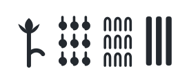
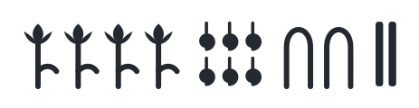
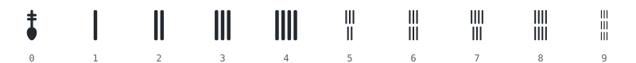

# egyptian-numerals

Render any number as [Egyptian hieroglyphic numerals](https://en.wikipedia.org/wiki/Egyptian_numerals): SVG with zero dependencies, plus PNG, JPEG and WebP through [sharp](https://sharp.pixelplumbing.com/).

**[Docs and playground](https://karlnorling.github.io/egyptian-numerals/)** · [Storybook](https://karlnorling.github.io/egyptian-numerals/storybook/)

| Package                                                           | What it does                                     |
| ----------------------------------------------------------------- | ------------------------------------------------ |
| [`@egyptian-numerals/core`](packages/@egyptian-numerals/core)     | Numbers to SVG. No dependencies, runs anywhere.  |
| [`@egyptian-numerals/raster`](packages/@egyptian-numerals/raster) | Numbers to PNG, JPEG or WebP in Node, via sharp. |
| [`@egyptian-numerals/cli`](packages/@egyptian-numerals/cli)       | The `egyptian` command.                          |

<p>
  
  
  
  
</p>
<p>
  
  
</p>

Ancient Egyptian hieroglyphs had a sign for each power of ten, from a single stroke for one to the god Heh, arms raised, for a million. A number repeats each sign as often as it needs, largest first. Fractions were written as sums of unit fractions, 1/n, with the mouth sign over the n, plus a special sign for 2/3.



## Usage

```sh
npm install @egyptian-numerals/core
```

```js
import { toSvg } from '@egyptian-numerals/core';

const svg = toSvg(1993);
const red = toSvg(1993, { size: 200, color: '#c00', background: 'white' });
```

```sh
npm install @egyptian-numerals/raster
```

```js
import { toImage } from '@egyptian-numerals/raster';
import { writeFile } from 'node:fs/promises';

await writeFile('1993.webp', await toImage(1993, { format: 'webp', size: 400 }));
```

### Command line

```sh
npx @egyptian-numerals/cli 1993 > 1993.svg
npx @egyptian-numerals/cli 12.75 -o fraction.webp --size 200
npx @egyptian-numerals/cli -42 -o minus.png
```

Installed globally (`npm install -g @egyptian-numerals/cli`), the command is `egyptian`. Run `egyptian --help` for every option.

### Colours and gradients

`color` and `background` take any CSS colour, or a CSS gradient: `linear-gradient()`, `radial-gradient()` and their `repeating-` forms. A gradient spans the whole image.

```js
// Rainbow
toSvg('1234567', {
  color: 'linear-gradient(to right, #e03131, #f76707, #fab005, #40c057, #228be6, #7048e8, #be4bdb)',
});

// Christmas
toSvg('2026.1225', {
  color: 'repeating-linear-gradient(135deg, #e03131 0 3%, #ffffff 3% 6%)',
  background: 'radial-gradient(#2b8a3e, #0b3d20)',
});
```

## Numbers the Egyptians didn't write

Hieroglyphic numerals were additive, with no zero and a sign only up to a million. This library follows the scribes where it can:

| Input          | Drawn as                                 | Rule                                                                                                             |
| -------------- | ---------------------------------------- | ---------------------------------------------------------------------------------------------------------------- |
| `4622`         | 4 lotuses, 6 coils, 2 hobbles, 2 strokes | Each sign is repeated as often as its digit, largest first. Empty powers are simply left out.                    |
| `0.75`         | 1/2, 1/4                                 | Fractions become different unit fractions 1/n, written with the mouth sign over n.                               |
| `0.68`         | 2/3, 1/75                                | Two thirds has its own sign, used when it saves a part.                                                          |
| `0.999`        | 1/2, 1/4, 1/5, 1/25, 1/125, 1/1000       | When that gets unwieldy, the fraction is split over divisors of a power of ten instead. The shorter result wins. |
| `0.1234567891` | an error                                 | A fraction that needs more than ten parts, or a part smaller than 1/9,999,999, is refused. Round it first.       |
| `0`            | nfr                                      | Egyptians had no zero digit. Accounts marked a balance of nothing with nfr, “complete”.                          |
| `10000000`     | an error                                 | The signs stop at a million, so numbers stop at 9,999,999.                                                       |
| `-42`          | a bar, then 42                           | A bar before the number marks it negative.                                                                       |

1/2 had its own sign in hieroglyphs; this library writes it as the mouth over two strokes. The negative bar is a modern addition.

Inputs can be a `number`, a `bigint` or a decimal `string`. A number is first written in its shortest exact form, so `0.1` draws as `0.1`. Strings and bigints keep every digit.

## API

### `toSvg(value, options?)` → `string` from `@egyptian-numerals/core`

| Option       | Default        | Notes                                                               |
| ------------ | -------------- | ------------------------------------------------------------------- |
| `size`       | `100`          | Image height in pixels. The width follows from the number of signs. |
| `color`      | `currentColor` | Colour of the signs. Takes a colour or a gradient.                  |
| `background` | none           | Colour or gradient behind the numeral.                              |
| `gap`        | `16`           | Space between groups, in viewBox units.                             |
| `padding`    | `20`           | Space around the numeral, in viewBox units.                         |
| `title`      | the number     | Accessible name. `false` leaves it out and sets `aria-hidden`.      |

### `toImage(value, options?)` → `Promise<Buffer>` from `@egyptian-numerals/raster`

Takes every `toSvg` option, plus `format` (`png`, `jpeg`, `jpg` or `webp`; default `png`) and `quality` (1–100). Colours default to black. JPEG gets a white background unless you pass one.

### Lower level, from `@egyptian-numerals/core`

- `parse(value)` → `{ negative, integer, fraction }`: the base-10 digits that get drawn.
- `format(parsed)` → the canonical decimal string, e.g. `-12.5`.
- `digitSvg(digit, place?, options?)` → one digit on its own.
- `parseGradient(css)` → the object form of a CSS gradient string, or `undefined` for a plain colour.
- `fractionSvg(fraction)` → one Egyptian fraction on its own.
- `egyptianFractions(digits)` → the fraction after the point as 2/3 and unit fractions.
- `breakdown(value)` → the signs a number is written with, group by group.
- `POWER_SIGNS`, `MOUTH`, `TWO_THIRDS` and `NFR` → the sign drawings, with their Gardiner codes.

## Development

```sh
yarn install
yarn test        # all packages, straight from source
yarn build       # core, then raster, then cli
yarn docs        # docs site with the playground, on localhost:4322
yarn storybook   # Storybook on localhost:6006
yarn examples    # regenerate examples/
```

## License

MIT
