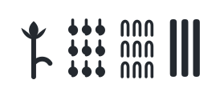
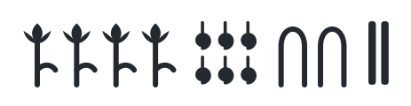

# @egyptian-numerals/core

Render any number as [Egyptian hieroglyphic numerals](https://en.wikipedia.org/wiki/Egyptian_numerals) in SVG. No dependencies; works in Node and the browser.

  

```sh
npm install @egyptian-numerals/core
```

```js
import { toSvg } from '@egyptian-numerals/core';

document.body.innerHTML = toSvg(1993, { size: 200 });

// Colours and backgrounds take CSS gradients too.
toSvg('1234567', {
  color: 'linear-gradient(to right, #e03131, #f76707, #fab005, #40c057, #228be6, #7048e8, #be4bdb)',
});
```

Fractions become unit fractions under the mouth sign, or 2/3, zero is nfr, and numbers stop at 9,999,999. For PNG, JPEG or WebP, use [`@egyptian-numerals/raster`](https://www.npmjs.com/package/@egyptian-numerals/raster).

See the [docs and playground](https://karlnorling.github.io/egyptian-numerals/) for every option and how numbers are drawn.

## License

MIT
